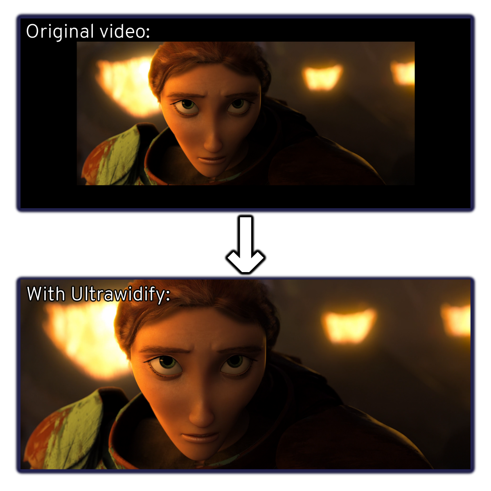
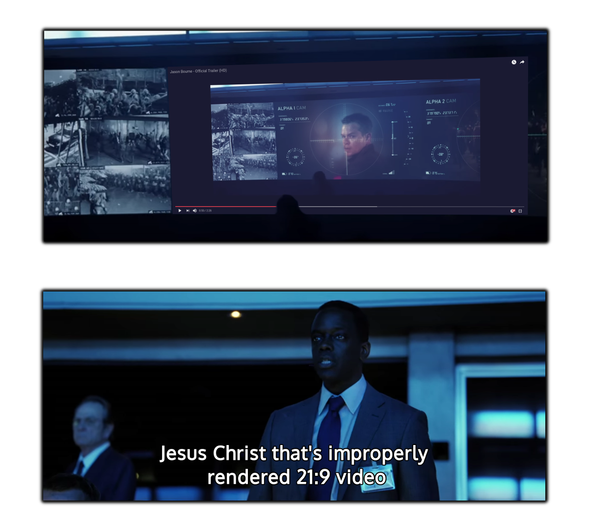

# Ultrawidify — aspect ratio fixer for youtube and netflix

## Super TL;DR: I'm just looking for the install links, thanks

[Firefox](https://addons.mozilla.org/en/firefox/addon/ultrawidify/), [Chrome](https://chrome.google.com/webstore/detail/ultrawidify/dndehlekllfkaijdlokmmicgnlanfjbi), [Edge](https://microsoftedge.microsoft.com/addons/detail/ultrawidify/lmpgpgechmkkkehkihpiddbcbgibokbi). 

Sometimes, testing versions will appear in the 'releases' tab.

## TL;DR

If you own an ultrawide monitor, you have probably noticed that sometimes videos aren't encoded properly — they feature black bars on all four sides. This could happen because someone was incompetent (note: as far as youtube is concerned, improperly rendered videos might be due to youtube's implementation of certain new features). The extension kinda fixes that by doing this:

## Known issues

* Autodetection doesn't work on sites that use DRM protection or strict CORS settings.
* Everything reported in [issues](https://github.com/tamius-han/ultrawidify/issues)

### Limitations

* Unclear how extension handles sites with more than one video per page.
* Autodetection is only correct 95% of the time, most of the time.
* On some sites, extension might not work out of the box. This happens because extension fails to guess which element is the video player. Try using `Video player options` → `Video player picker` to mark correct element as video player.

### Features

* **Automatic aspect ratio detection**
* **Crop to aspect ratio** — removes double letterbox, but doesn't crops the actual video content.
* **Zoom to aspect ratio** 
* **Stretch video to fit screen**
* **Supports Youtube theater mode**
* **Custom zooming and panning**
* **Configurable shortcuts**

### Website support

I am not actively testing extension on other sites other than youtube. You can try your luck and enable extension for any unsupported site you stumble across via extension popup, but I make no guarantees it will work everywhere.

If extension doesn't work for a site I'm not testing on out of the box, follow [this wiki](https://github.com/tamius-han/ultrawidify/wiki/Fixing-site-incompatibilites-('Advanced-settings')). The 'quick and dirty' approach should work for most sites. (If you try doing things the proper way, you should really know what you're doing.)

### Installing this extension

You can download this extension from the relevant extension stores:

* [Firefox](https://addons.mozilla.org/en/firefox/addon/ultrawidify/)
* [Chrome](https://chrome.google.com/webstore/detail/ultrawidify/dndehlekllfkaijdlokmmicgnlanfjbi)
* [Edge](https://microsoftedge.microsoft.com/addons/detail/ultrawidify/lmpgpgechmkkkehkihpiddbcbgibokbi)

Other browsers are not officially supported. If you're using a different Chromium-based browser, you can try installing the addon from the Chrome Web Store — but if things don't work, you're on your own.

# Beggathon (donations)

If you want to support this project, please consider a donation. Working on this extension takes time, money, coffee and motivation. Sometimes also [a very precise amount of alco](https://xkcd.com/323/).

You can make a donation [via Paypal](https://www.paypal.me/tamius).

**Any donation — no matter how big or small — is well appreciated. Thanks.**

&nbsp;

&nbsp;

&nbsp;

&nbsp;

# The long version

The technology has been here for a while, but plenty of people don't know how to properly encode a video (despite the fact [youtube has an article that explains aspect ratios](https://support.google.com/youtube/answer/6375112)). Plenty of people surprisingly includes major Hollywood studios, such as [Marvel](https://www.youtube.com/watch?v=Ke1Y3P9D0Bc), [Disney](https://www.youtube.com/watch?v=yCOPJi0Urq4), [Dreamworks](https://www.youtube.com/watch?v=oKiYuIsPxYk), [Warner Brothers](https://www.youtube.com/watch?v=VYZ3U1inHA4), [Sony](https://www.youtube.com/watch?v=7BWWWQzTpNU), et cetera. You'd think that this is the one thing Hollywood studios and people who make [music videos for a living](https://www.youtube.com/watch?v=c6Mx2mxpaCY) would know how to do right, but they don't. This extension is here to fix that.

## Features

Most settings are self-explanatory, but we'll get into details anyway. 

### Automatic aspect ratio detection

By default, automatic detection will run on every site this extension is enabled for. It does what it says on the tin: it attempts to detect aspect ratio of the video by periodically looking at a video frame.

Some caveats apply:
* autodetection is very easy in 99% of cases and very tricky in the 1%. Sometimes, autodetection will be too eager. Sometimes it won't be eager enough.
* Some sites use DRM. DRM measures are designed specifically to prevent scripts from looking at video frames. Since that's exactly what this extension uses to determine aspect ratio of a video, **autodetection is not possible on sites that use DRM** (Netflix and the likes). Firefox is slight exception to this.
* Firefox offers an API that can be used to take screenshots of the page. Turns out that you can use this API to work around the above limitation. Usage of this API has its own limitations. Due to those limitations, automatic detection on DRM-protected sites in Firefox keeps a thin black bar at the top and the bottom of the video.

Autodetection can be enabled or disabled globally, per site or per video.

### Popup

Most of the extension settings can be accessed and modified via the popup. If extension is enabled for the site you're currently on, the popup will display options for the video you're currently watching.

### In-player UI

Since extension popup is inaccessible while in full screen, there is also in-player UI.

### Cropping and zooming

Extension can crop videos to the desired aspect ratio. Crop option will only remove instances of double letterboxing. Cropping options will only crop video if cropping can be done without cropping the actual video content.

Zoom options will remove all letterboxing, even in cases where cropping would result in video content being cropped.

Out-of-the-box, extension only offers shortcuts for cropping the most popular aspect ratios for video content that tend to cause issues on ultrawide monitors. Custom aspect ratios can be added in extension settings.

You can manually zoom by using zoom sliders in the in-player UI or extension popup, or using the 'Z' and 'U' keyboard shortcuts. You can use those to zoom farther than merely adjusting aspect ratio would.

### Video alignment and panning

If you watch 16:9 videos in full screen on a 21:9 monitor, there's obviously going to be black bars on either side of the video. The video will be centered, though. Some people don't want video to be centered in such situations, instead preferring having the video aligned to either side. **Video alignment** option does that.

At high magnification, you can pan the video by moving mouse over it while holding the shift key.

### Stretching videos

When you watch a 16:9 content on a 21:9 monitor, you can deal with this issue in three ways: A) you don't, B) you crop or C) you stretch the 16:9 video to fit a 21:9 container. Obviously not everyone is a person of culture, some people prefer to choose the greater evil of the three: they prefer their videos stretched!

Ultrawidify offers you several ways of dealing with the issue:
* **Never** — don't stretch at all
* **Basic** — stretch the video to fit screen. Doesn't remove black bars encoded in the video. While this option is active, automatic aspect ratio detection is disabled.
* **Hybrid** — this mode first crops away the black bars encoded in the video file. If the video doesn't fit your monitor after being cropped, the extension will proceed to stretch it in a smart way. Automatic detection remains active with this option.
* **Thin borders** — this mode only applies stretching only when borders around video are thin (less than 5% of total width or height).

## Global and per-site default settings

You can change default settings for extension or site you're currently on by visiting 'Extension settings' and 'Site settings' tabs in the popup. Per-site settings override extension defaults, video settings override both.

## Installing

### Permanent install / stable

[Latest stable for Firefox — download from AMO](https://addons.mozilla.org/en/firefox/addon/ultrawidify/)

[Latest stable for Chrome — download from Chrome store](https://chrome.google.com/webstore/detail/ultrawidify/dndehlekllfkaijdlokmmicgnlanfjbi)

[Latest stable for Edge — Download from Microsoft store](https://microsoftedge.microsoft.com/addons/detail/lmpgpgechmkkkehkihpiddbcbgibokbi)

### Installing the current, github version

This project does not have nightly builds. However, when new features are being added, versions intended for testing will appear in the `releases` tab. 

## Build from source

Requirements: nvm, npm, node.

1. Clone this repo
2. `nvm use`
2. `npm ci`
4. `npm start`

2. Open up Firefox (or Chrome)
3. Go to `about:debugging` (or Chrome equivalent)
4. Add temporary addon
5. Select `${ultrawidify_folder}/dist/manifest.json`

# Changelog

see changelog.md

todo: add link to changelog.md here
